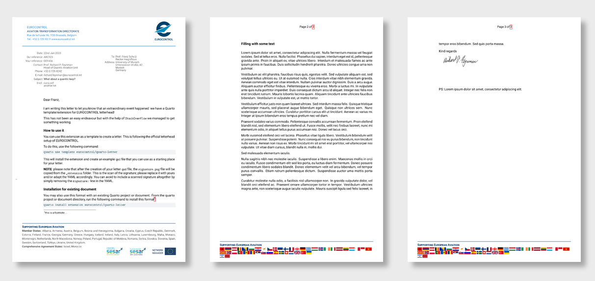

<!-- README.md is generated from README.qmd. Please edit that file -->

# EUROCONTROL Letter Format Template

This is a Quarto template that assists you in creating a letter on
EUROCONTROL letterhead

## Creating a new letter

You can use this as a template to create a letter. To do this, use the
following command:

``` bash
quarto use template eurocontrol/quarto-letter
```

This will install the extension and create an example `qmd` file that
you can use as a starting place for your letter.

**NOTE**: please soon after the creation of your letter remember to
render the `qmd` twice for the first time. This will copy the needed
files

## Installation for existing document

You may also use this format with an existing Quarto project or
document. From the quarto project or document directory, run the
following command to install this format:

``` bash
quarto install extension eurocontrol/quarto-letter
```

## Customisation

The template shows examples of possible customizations via YAML in the
front matter. Some keys/values are typical of a business letter, such
as:

- `subject`: for the topic of the letter

- `ourreference`: the reference of the sender

- `yourreference`: the reference for the addressee

- `fromname`/`toname`: the name and affiliation of the sender/recipient,
  as an array of values. For example:

  ``` yml
  fromname:
    - Prof. Richard P. Feynman
    - Head of Quantic Aviation Unit
  ```

- `fromemail`: the electronic email of the sender

- `fromphone`: the phone number of the sender

- `signatureimage`: the file for the scan of the signature

- `directorate`: the directorate of the sender, if not present by
  default `Aviation Transformation Directorate`

- `directorateaddress`: a one-liner, by default the EUROCONTROL HQ
  address

- `directorateetal`: a one-liner, by default
  `Tel.: +32-2-729.90.11     www.eurocontrol.int`

- `toaddress`: the address of the recipient, as an array of values; for
  example:

  ``` yml
  toaddress:
    - University of Munich
    - Unterwasser straße, 42
    - Munich
    - Germany
  ```

- `opening`: The letter opening, i.e. “Dear Franz,”

- `closing`: The letter closing formula i.e. “Kind regards”

- `ps`: the post-scriptum, i.e.

  ``` yml
  ps: |
    PS: Lorem ipsum dolor sit amet, 
    *consectetur* adipiscing elit.
  ```

- `encl`: an array of values for the list of annexes, i.e.

  ``` yml
  encl:
    - cucu.pdf
    - another.txt
  ```

## Example

[](examples/template.pdf)
